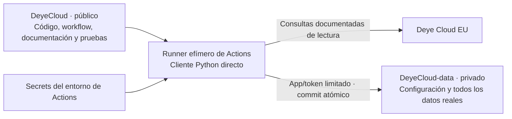

# Recopilación diaria: código público, datos privados

La implementación queda preparada en local. **No se han creado repositorios
remotos, publicado cambios, activado workflows ni configurado secretos.** El job
no se ejecuta si la variable de repositorio `DEYE_AUTOMATION_ENABLED` no vale
exactamente `true`. El ejecutable también exige esa autorización explícita.

## Arquitectura definitiva



El recolector importa `deye_client.py` y sus contratos históricos. No necesita
Codex, MCP Inspector, el SDK MCP ni un servidor MCP en ejecución. Instala solo
`requirements-actions.txt`; el servidor local continúa disponible por separado.

El destino debe llamarse `DeyeCloud-data`. Antes de consultar Deye se comprueba
mediante la API de GitHub que sea **privado**, con visibilidad `private`, y distinto
del repositorio público. Se exige que exista la rama `main`, ya inicializada.
No hay checkout de datos privados, archivos de resultados en el workspace público,
artefactos, cachés ni resúmenes de Actions con datos de la instalación. Los datos
de lectura se procesan en memoria y se guardan únicamente en el repositorio privado.

## Qué se ejecutará automáticamente después de autorizarlo

1. Checkout del código público, sin persistir credenciales de Git; instalación de
   Python 3.12 y dependencias del recolector con versiones fijadas.
2. Comprobación del árbol público, índice e historial Git disponible, y pruebas
   del recolector con respuestas simuladas. Todavía no se suministran secretos Deye.
3. Obtención de un token de instalación de una GitHub App restringido al repositorio
   privado, con `Contents: write`. Alternativamente, PAT de alcance fino explícito.
4. Lectura de `config/installation.json` desde el repositorio privado y validación
   de instalación, inversor, pertenencia del dispositivo y zona horaria.
5. Consulta del **último día completo de Europe/Madrid y sus tres días anteriores**,
   excluyendo fechas anteriores a `installation_start`. No se consulta el día actual.
6. Recuperación de resúmenes diarios de instalación/dispositivo y dos grupos de
   curvas por día: SOC/temperaturas y potencias FV/vivienda/red/batería. Solo se
   solicitan claves que el inversor declare disponibles. Se leen también los
   parámetros actuales de sistema, batería y TOU; no se emiten órdenes.
7. Validación y construcción de todos los cambios en memoria. Publicación mediante
   una única actualización no forzada de la referencia `main` del repositorio privado.

La ejecución manual admite únicamente `end_date`, una fecha cerrada `YYYY-MM-DD`.
Consulta esa fecha y las tres anteriores, respetando el comienzo de la instalación.
Permite recuperar interrupciones largas por bloques de cuatro fechas. Nunca se
introducen estaciones, series, coordenadas, credenciales o parámetros reales en
los inputs públicos de un workflow.

## Programación, cambios de horario y límites de GitHub

El archivo `.github/workflows/deye-daily.yml` es JSON, un subconjunto válido de
YAML; las pruebas pueden analizarlo con la biblioteca estándar, sin instalar
un parser adicional. Usa `schedule: cron '30 2 * * *', timezone 'Europe/Madrid'`
y `workflow_dispatch`. No tiene triggers `push`, `pull_request` o
`pull_request_target`, ni ejecuta código de ramas distintas de la predeterminada.
Las Actions de checkout, Python y token de App están fijadas por SHA completo.

GitHub permite actualmente zonas IANA en `schedule`. En el salto de primavera,
su documentación desplaza una programación de las 02:30 a las 03:00. La hora
repetida de otoño no se usa como garantía de una única ejecución: los datos se
actualizan por fecha y la persistencia soporta ejecuciones duplicadas. Los límites
de día proceden de `zoneinfo`/`tzdata`, con días de 23, 24 o 25 horas, no de restar
86400 segundos. [Sintaxis oficial de programación](https://docs.github.com/en/actions/reference/workflows-and-actions/workflow-syntax#onschedule).

La programación no garantiza puntualidad: puede retrasarse y GitHub puede omitir
ejecuciones durante congestión. Solo funciona en la rama predeterminada. Además,
en repositorios públicos GitHub desactiva los workflows programados tras 60 días
sin actividad en ese repositorio; los commits del repositorio privado **no son una
estrategia de mantenimiento de actividad del público**. Hay que vigilar ese estado
y reactivarlo con autorización si ocurre. No se generan commits públicos de
relleno. [Eventos y restricciones oficiales](https://docs.github.com/en/actions/reference/workflows-and-actions/events-that-trigger-workflows#schedule).

Concurrencia: un grupo para todas las ejecuciones, `cancel-in-progress: false`;
timeout de 15 minutos. GitHub no garantiza conservar una cola ilimitada de
ejecuciones pendientes; la recuperación se basa en la ventana solapada y el
backfill manual, no en el número de disparos de cron.

## Autenticación y permisos mínimos

El cliente conserva Windows Credential Manager como origen predeterminado local.
Solo `DEYE_AUTH_MODE=environment`, o el modo explícito del recolector, cambia a
las cuatro variables de entorno. Si falta alguna, falla sin acudir a las
credenciales locales. La contraseña original se transforma con SHA-256 mediante
el código existente. Tokens Deye solo en memoria; nunca se archivan las respuestas
de autenticación. No se han configurado valores reales durante esta preparación.

Secretos que deberán existir en el **entorno `deye-production`** del repositorio público:

| Secret | Uso |
|---|---|
| `DEYE_APP_ID` | AppId existente de Deye EU |
| `DEYE_APP_SECRET` | Secreto de esa aplicación Deye |
| `DEYE_EMAIL` | Identificador de autenticación |
| `DEYE_PASSWORD` | Contraseña original, no el hash previamente calculado |
| `DEYE_DATA_APP_ID` | ID de la GitHub App, opción preferida |
| `DEYE_DATA_APP_PRIVATE_KEY` | Clave privada PEM de esa App |
| `DEYE_DATA_TOKEN` | Solo en la alternativa PAT; no necesario con App |

Variables no secretas de repositorio:

| Variable | Valor o comportamiento |
|---|---|
| `DEYE_AUTOMATION_ENABLED` | Ausente/`false` hasta autorización; `true` solo al activar |
| `DEYE_DATA_OWNER` | Propietario de `DeyeCloud-data`; por defecto el propietario del público |
| `DEYE_DATA_AUTH_MODE` | Ausente/`app` para App; `pat` para la alternativa explícita |

`GITHUB_TOKEN` solo tiene `contents: read` sobre el repositorio público, sin
`id-token`, escritura de contenidos, administración, secretos, workflows o
artefactos. La App debe instalarse **solo en `DeyeCloud-data`**, con Contents de
lectura/escritura y la lectura de Metadata implícita. No necesita permisos sobre
el repositorio público ni sobre Actions. Su token se limita de nuevo a ese único
repositorio y se revoca al terminar mediante la Action oficial. No se desactiva
la revocación. [Action oficial y permisos explícitos](https://github.com/actions/create-github-app-token/tree/v2.2.1).

Alternativa: PAT **fine-grained**, limitado únicamente a `DeyeCloud-data`, Contents
de lectura/escritura, Metadata de lectura y caducidad corta. No usar un PAT clásico
con alcance amplio `repo`. El código no incluye credenciales Git, URLs con tokens,
`git push` autenticado ni cabeceras persistidas en `.git/config`.

Revocación: suspender/desinstalar la App o revocar su clave, o revocar el PAT;
retirar los Secrets correspondientes y poner `DEYE_AUTOMATION_ENABLED=false`.
Ante exposición de una credencial Deye, rotarla en su origen y sustituirla en
Secrets. No basta borrar el valor de un archivo o eliminar el Secret de Actions.

Los mantenedores que puedan modificar código ejecutado con Secrets son una
frontera de confianza: proteger la rama predeterminada, revisar cambios de código
y workflow, y limitar quién puede administrar el entorno y sus Secrets. El
entorno debe permitir únicamente esa rama. No se requieren revisores en cada
ejecución diaria si se desea automatización desatendida; la autorización inicial
y la protección de los cambios siguen siendo necesarias. No activar debug de
runner/peticiones ni volcar el entorno.

## Configuración y estructura del repositorio privado

El público contiene únicamente `config/data.example.json`, deliberadamente
incompleto. Después de autorizarlo, habrá que copiarlo a
`DeyeCloud-data/config/installation.json` y sustituir privadamente:

- `station_id`: ID completo de la instalación.
- `device_sn`: serie completa del inversor seleccionado.
- `installation_start`: fecha real de puesta en servicio, formato `YYYY-MM-DD`.
- `timezone`: `Europe/Madrid`.

No se escribe esa configuración en el público ni se usa un archivo `.env`
versionado. El recolector no modifica `config/installation.json`.

```text
DeyeCloud-data/                   # privado, rama main
  config/installation.json        # configuración real, provisionada por el propietario
  originals/<sha256>.json         # payloads originales de consultas de lectura
  daily/YYYY-MM-DD.json           # energía diaria por fuente y calidad
  intraday/YYYY-MM-DD.json        # muestras por timestamp/medida, unidades explícitas
  consumption/YYYY-MM-DD.json     # consumo, compra y exportación reportados
  parameters/latest.json         # parámetros leídos; puntos no admitidos diferenciados
  state/collection.json           # última ventana consultada y hashes de originales
```

Los originales conservan el payload de lectura previo a la proyección del
cliente, **exceptuando mensajes y metadatos de autenticación**. Nunca se archivan
el endpoint de token, contraseñas, tokens, cabeceras, `msg` o `requestId`. Además
se retiran de strings los valores de los Secrets y del token en uso. No son
capturas HTTP byte a byte. Los originales se direccionan por hash del contenido;
consultar otra vez una respuesta idéntica no crea otra copia lógica.

Los identificadores y valores reales pueden estar completos en este repositorio
privado, pero no salen en logs, nombres de jobs, mensajes de commit, artefactos
ni salidas del recolector. Los informes privados que ya existan localmente se
conservan ignorados; migrarlos al privado también queda pendiente de autorización.
No se sobrescriben `Configuracion.md` o `Consumos.log`.

## Persistencia, validación y recuperación

- JSON canónico, hashes de contenido y upsert por fecha. La misma respuesta
  produce los mismos blobs; si no cambia nada no se crea commit. Los consumos
  usan un archivo por día, sin líneas duplicadas por reejecución.
- Los tres días anteriores se vuelven a consultar siempre. Un valor tardío
  válido reemplaza el anterior. Un valor ausente no elimina una observación
  válida: se retiene y se marca como retenido. Lo mismo ocurre con las muestras.
- Los resúmenes conservan por separado las fuentes estación/dispositivo. Los
  kWh diarios se validan con las unidades explícitas del dispositivo y los campos
  documentados de estación; no se fuerza el cierre de un balance ni se cambia
  el significado de la compra reportada.
- Se validan fecha, ventana, duplicados, números finitos, unidades, SOC 0–100 y
  zona horaria fuente frente a Madrid. Los huecos no son ceros. W/kW no se suman
  como kWh; no se inventa energía horaria. Temperaturas negativas se conservan
  sin aplicar offsets supuestos. Las incompatibilidades conocidas del resumen y
  curva de estación no se usan como fuentes para esta recopilación.
- Límites: máximo **32 peticiones HTTP Deye**, incluida autenticación, espaciadas
  al menos **2,1 s**; hasta **128 peticiones del almacén a la API GitHub** (sin
  contar checkout y obtención/revocación del token de App); TLS verificado,
  redirecciones rechazadas y respuestas acotadas. No hay bucles de reintento.
  Un 429, fallo de red o formato obligatorio inválido aborta la transacción.
- Los puntos opcionales no admitidos, sin permisos o con dispositivo offline
  quedan diferenciados; se conserva la última lectura disponible de parámetros.
- Se crean blobs, árbol y commit en el **privado**, y solo al final se actualiza
  `refs/heads/main` con `force: false`, padre igual al commit leído inicialmente.
  Un conflicto de otro escritor falla sin forzar ni rebasar silenciosamente.
  [Semántica oficial de actualización de referencias](https://docs.github.com/en/rest/git/refs#update-a-reference).
- La visibilidad privada se vuelve a comprobar antes de enviar blobs y antes
  de actualizar la rama. Los administradores del destino siguen siendo una
  frontera de confianza: no deben cambiar su visibilidad durante la recopilación.
- El cambio visible de rama es atómico para el lote completo. Una interrupción
  anterior puede dejar objetos privados sin referencia, pero no medio lote
  visible ni archivos de datos en el público. Si el servidor completó el cambio
  y se perdió su respuesta, volver a ejecutar es seguro por idempotencia.
- No se modifican los checkpoints hasta construir un lote válido. La ejecución
  siguiente recupera la ventana solapada; interrupciones mayores requieren un
  backfill manual por bloques. `last_target_date` describe la última consulta,
  no garantiza que existieran datos en todas sus fechas.

## Preparación local y comprobaciones realizadas

Archivos creados:

| Archivo | Función |
|---|---|
| `.github/workflows/deye-daily.yml` | Programación/manual, permisos, concurrencia, gate y autenticación de App |
| `scripts/collect_deye_daily.py` | Recopilación directa, validación, correcciones tardías y lote de datos |
| `scripts/deye_private_store.py` | API Git del destino privado, blobs idempotentes y commit atómico |
| `scripts/check_publication.py` | Revisión de árbol, índice e historial sin imprimir valores sensibles |
| `requirements-actions.txt` | Dependencias independientes del SDK MCP |
| `config/data.example.json` | Plantilla sin configuración real |
| `tests/test_daily_collection.py` | Simulación del cliente, persistencia, calendario y workflow |
| `tests/test_publication.py` | Privacidad en contenidos, índice, archivos eliminados e identidad Git |
| `docs/automation.md` | Esta arquitectura e instrucciones |

Archivos modificados: `scripts/deye_client.py` (origen de autenticación explícito,
observer privado y presupuesto), `scripts/setup_credentials.py` (importación
compatible con Linux, sin alterar el almacenamiento Windows),
`tests/test_deye_local.py` (plantilla portable y fixture Windows condicionado),
`.gitignore`, `README.md`, `docs/deye_local.md` y `docs/PUBLICATION.md`.
Los archivos de revisión locales bajo `_local/` permanecen excluidos de Git.

```powershell
.\.venv\Scripts\python.exe -B -m unittest discover -s tests -v
.\.venv\Scripts\python.exe -B scripts/check_publication.py
```

La suite incluye pruebas MCP/locales y pruebas nuevas independientes del SDK MCP.
El workflow ejecuta únicamente `test_daily_collection.py`, con `requests` y
`tzdata`, sin lecturas reales de Deye o del Administrador de credenciales.
Los tests del almacén simulan visibilidad pública, permisos/fallos, conflictos,
presupuesto, idempotencia y actualización no forzada. También se prueban calendario,
horario de verano, datos tardíos, campos ausentes, unidades y salida saneada.
La suite local completa supera **59 pruebas**; las **15 pruebas del recolector**
también se ejecutaron con importaciones de MCP, AnyIO y bibliotecas Windows
bloqueadas y el backend sin Windows cargado. Esto comprueba la separación de
dependencias; el workflow hospedado real no se ha ejecutado, pendiente de autorización.

La revisión inicial del historial local encontró **un commit y 19 blobs históricos**.
No se detectaron secretos ni evidencias de instalación en sus contenidos. Sí se
detectó una identidad de autor/committer con correo que no es `noreply`; el scanner
lo marca `GIT_IDENTITY_REVIEW` sin mostrar el correo. **La revisión de publicación
no se considera aprobada mientras exista este hallazgo.** No se ha reescrito el
historial ni cambiado la configuración Git. Tampoco se ha inspeccionado un remoto
no autorizado: el alcance es refs y reflogs locales, índice y árbol no ignorado.

El scanner busca también archivos históricos ya borrados y el contenido del
índice, no solo `.gitignore`; sus pruebas comprueban esos casos. Es una comprobación
local reproducible y acotada, no una garantía absoluta contra cualquier secreto.
Antes de publicar o activar, repetirla sobre todo el historial que se vaya a enviar.

## Pasos pendientes que requieren autorización, al final

1. **Resolver la identidad Git histórica.** Elegir el correo `noreply` del
   propietario y autorizar, si procede, cambiar la autoría del primer commit.
   Si ya se publicó, acordar antes la reescritura y su efecto en otros clones;
   si se detectase un secreto, revocarlo además de sanear el historial. No ejecutar
   un force-push sin autorización. Repetir la revisión sobre las refs publicables
   y revisar conscientemente los reflogs antiguos conservados solo en local.
2. **Crear/configurar los repositorios**: `DeyeCloud` público y `DeyeCloud-data`
   privado, inicializar `main` del privado y guardar allí la configuración real.
   Mantener Actions desactivado y la variable de habilitación ausente/false al
   publicar por primera vez. No copiar las evidencias locales al público.
3. **Crear/instalar la App**, solo en el privado y con los permisos descritos,
   o emitir el PAT fino alternativo. Configurar los Secrets del entorno y las
   restricciones de rama. No introducir valores reales en código o documentación.
4. **Revisar y publicar estos cambios** únicamente tras aprobar la revisión de
   privacidad. Este trabajo no realiza commit, push ni crea un PR.
5. **Autorizar la puesta en marcha**: activar Actions, establecer
   `DEYE_AUTOMATION_ENABLED=true` y ejecutar manualmente desde la rama predeterminada.
   Comprobar en el privado que los originales, resúmenes, consumos y parámetros
   son correctos. Solo después dejar habilitada la programación diaria.

Hasta completar esos pasos no se ejecuta la recopilación real ni se realiza
ninguna operación remota con los repositorios del propietario.
